# Perturbation-symptom modules: study sheet

The owner's study sheet, exported from Claude Docs (https://claude.ai/artifact/RzVm4LjdeHmzzdSyzJ5j65). The doc is the version that is kept current; this file is its Markdown copy, refreshed in place by exporting it again (last from revision 44, 7 November 2026). The text is the doc's own Markdown export; the 19 diagrams, which that export leaves out, are rendered as PNG images in [`study_sheet_figures/`](study_sheet_figures/), each followed by its caption. From 27 October to 7 November 2026 the copy was a dated record, an export of revision 36 with an HTML page and 12 figures, filed under the date of that export; the owner asked on 7 November 2026 that the date be removed from the file names, and git holds that version.

Oct 25, 2026 · @Bryan Nova

## Start here

The project propagates gene and drug perturbations through a signed physiology graph (about 50,000 nodes and 270,000 edges) to a fixed point, then scores the predicted symptoms against public labels; its purpose is the basis for a data-defined psychiatric nosology. On `main` at `f54e3e9` (25 October 2026) there are no open pull requests, work is pushed straight to `main`, one model is registered and **80 decisions wait on you** (`docs/status.md`).

Of those 80, only a few gate any work. Rule on these first:

- [ ] **9.97, two questions.** Is insensitivity shown only in reconstituted or transfected systems enough to remove a Gi/o-to-cyclase edge? How should "raises Gs-stimulated activity, no effect alone" (G beta gamma on ADCY2, 4, 5, 6, 7) be represented? Nothing in the cyclase correction starts until both are answered.
- [ ] **9.87, the membrane-potential build.** Every rebuild still builds `learned_from_reactions`, while item 13 registers `computed_beside_the_reactions`. The rebuild the cyclase work needs runs into this.
- [ ] **Fagerholm preprint.** Withdraw and record (keep mentions, mark excluded, re-justify item 15 on the repository's own species mix) or delete from the living documents. Needs a decision id and an `Amends:` trailer.
- [ ] **One physical action.** Keep a copy of the four GEO GSE100472 files outside the container; no session can refetch them.

The cheapest experiment nobody has run is **R0**, the rate-invariance check: minutes on a CPU, no training and no new labels (`readout_and_timescales_2026-10-24.md`, section 5).

## The pipeline

A perturbation enters as a signed seed, settles through one damped linear operator and is read out per symptom; only stage 4 holds learned propagation, and the labels meet the predictions only at scoring.

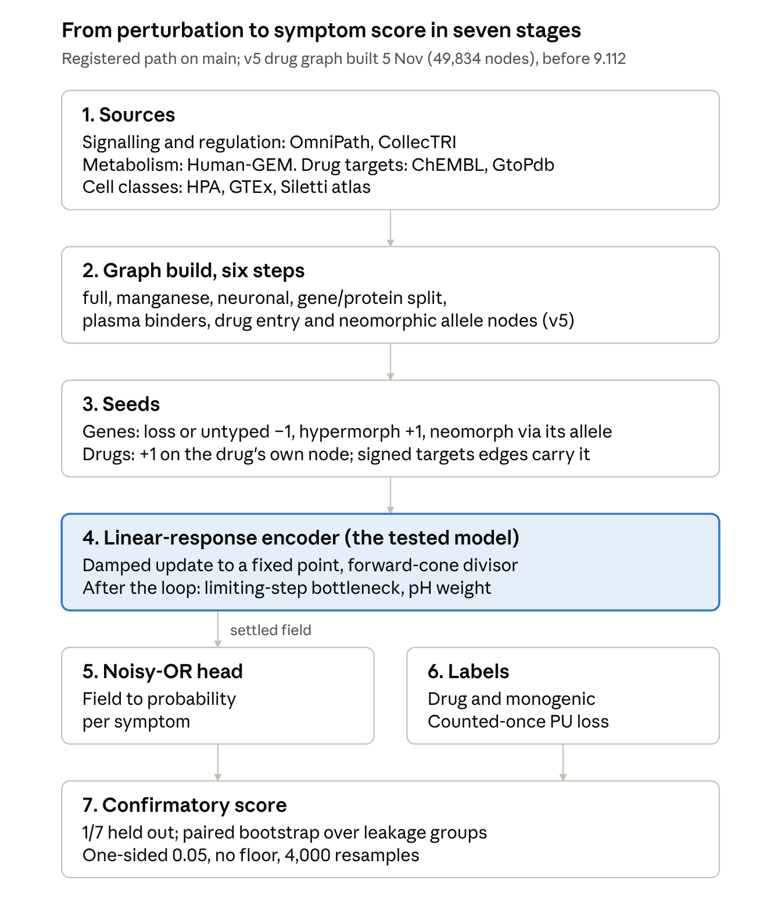

*registered pipeline · 7 stages · from registered_rules.json and the 21 Oct rebuild chain*

The nonlinearities switched on by default (bottleneck, pH weight) sit after the loop; the in-loop aggregators and edge gates are off, so none of them can change the route a signal takes, only its size at the end.

### How the model is fit and tested

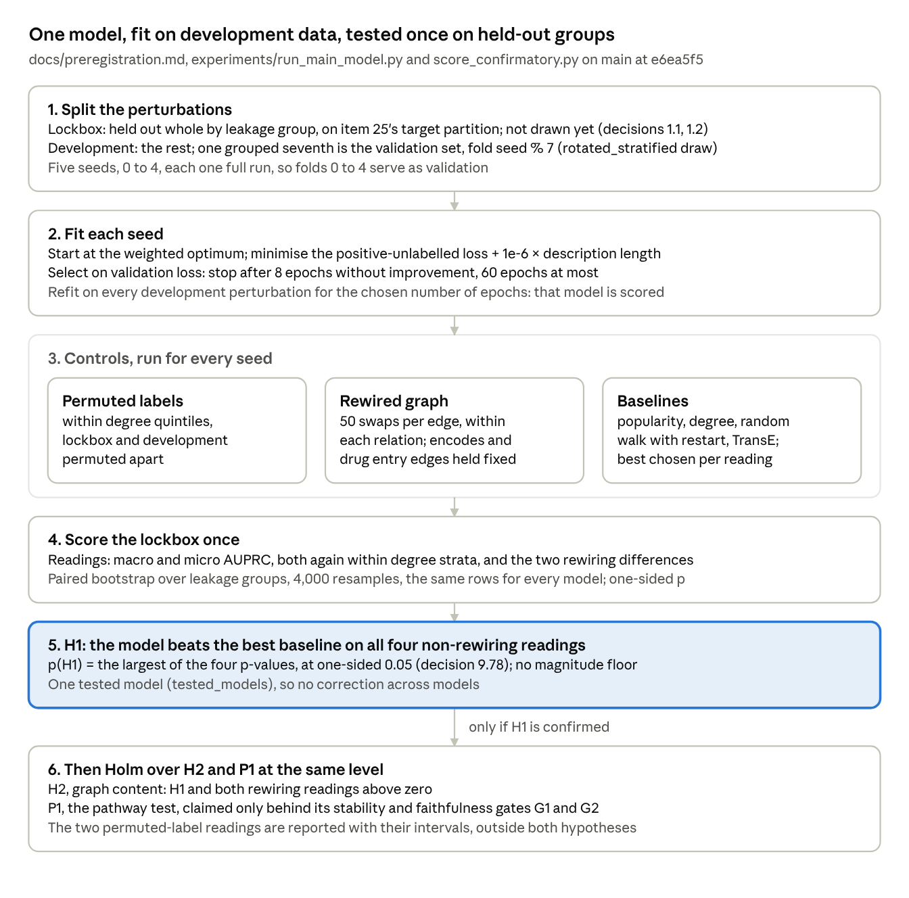

*fit and test · docs/preregistration.md, run_main_model.py, score_confirmatory.py on main at e6ea5f5; built and decided agree*

The lockbox is touched once, after every seed and control has run; until the owner's go-ahead (decision 1.1) it is not even drawn.

### What the graph holds

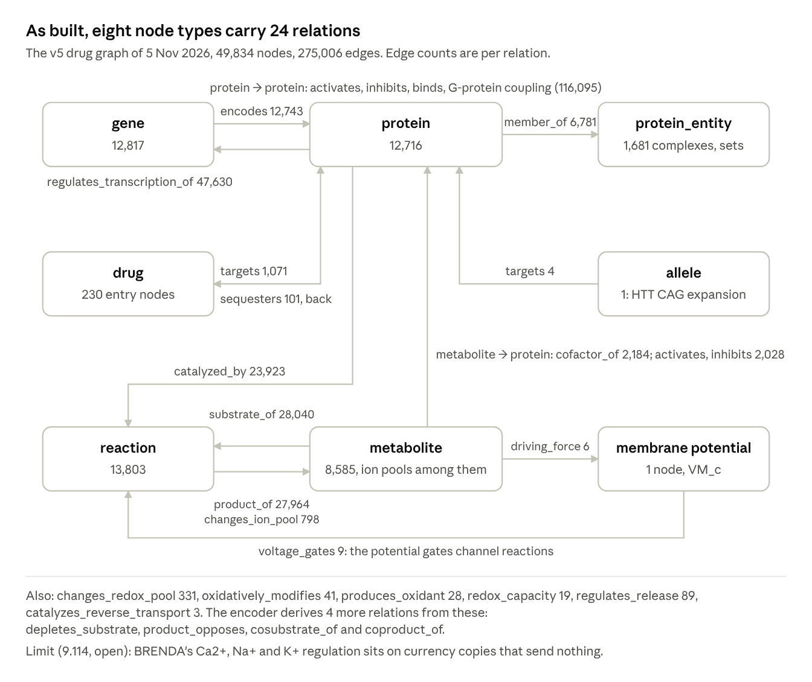

*graph schema, as built · graph_full_neuronal_split_binders_drugs_v5 of 5 Nov 2026 (49,834 nodes, 275,006 edges), before decision 9.112*

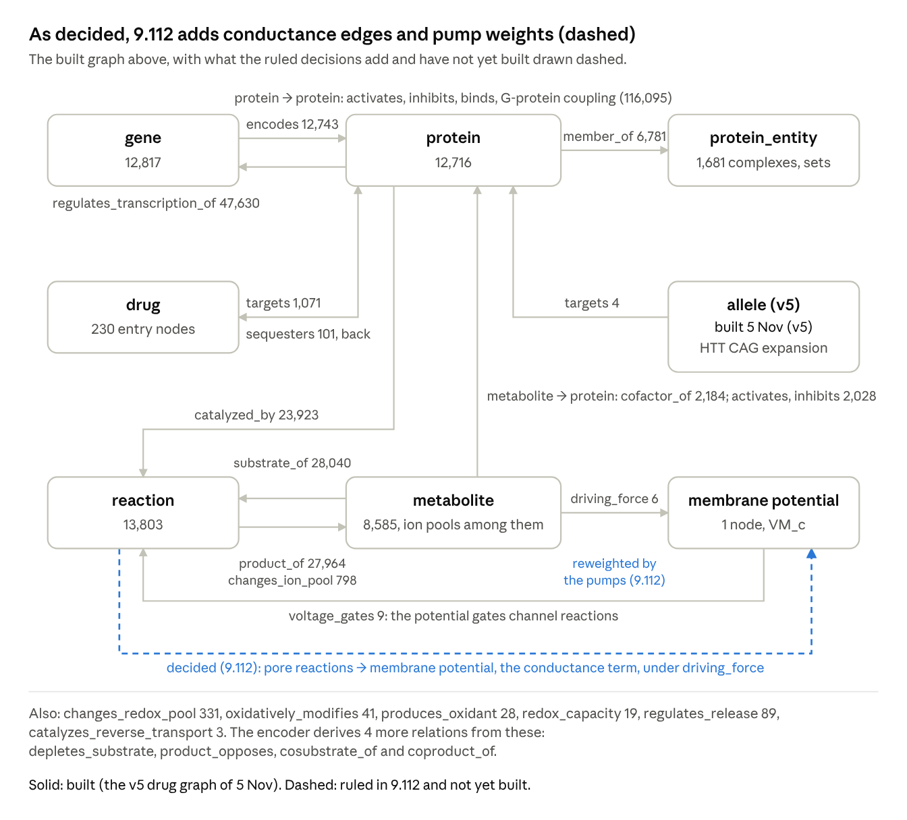

*graph schema, as decided · solid: the v5 graph of 5 Nov 2026; dashed: decision 9.112, ruled 4 Nov 2026 and not built*

A gene perturbation seeds its gene node (−1 for a loss or untyped allele, +1 for a hypermorph); a drug seeds its own node at +1 and reaches its targets through signed `targets` edges, which skip the divisor.

## Architecture

The model is four learned transforms around one linear loop: input weights and relation gains feed the fixed point, a gated expansion reads it out and a noisy-OR head turns it into symptom probabilities. Everything that is not linear acts after the loop or in the head.

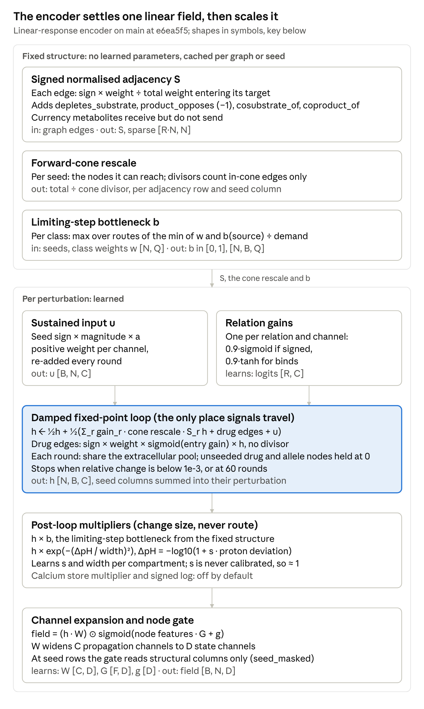

*mechanistic_pathway_learning/models/linear_response_encoder.py on main at f54e3e9*

Key: B perturbations, P seeds per perturbation, N nodes, R relations, Q cell classes, C propagation channels (Q × channels per class), D state channels, F node feature columns, M pathway modules, S symptoms. Under `forward_cone` each seed is propagated as its own column with its own divisor; that is exact only because everything inside the loop is linear in the input.

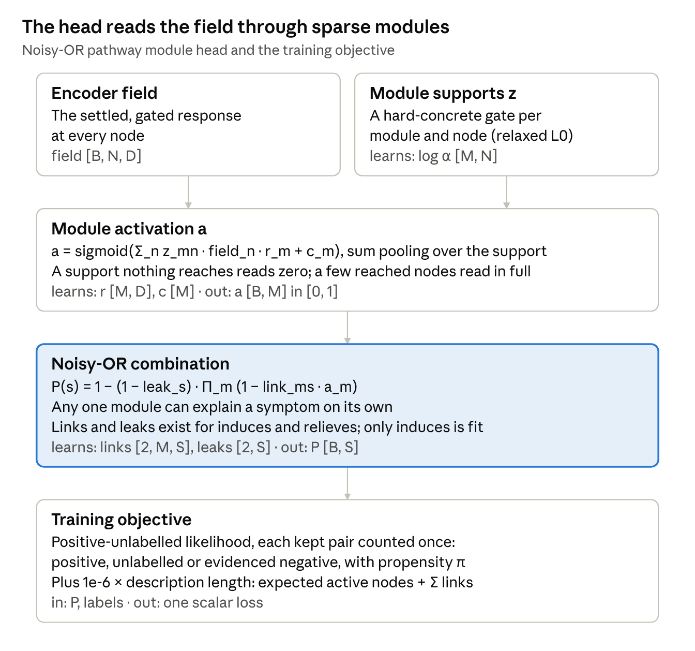

*models/noisy_or_pathway_module_model.py and configs/registered_rules.json on main at f54e3e9*

Two things in the code are worth knowing for the nonlinearity question. The bottleneck b uses no learned parameter and runs under no gradient, so it cannot be fitted. The pH multiplier has learned parameters, but its sensitivity starts at 1 and `calibrate_ph_sensitivity` is never called, so against deviations of order 1e-11 it stays at 1 with no gradient.

### Robustness and exploratory arms

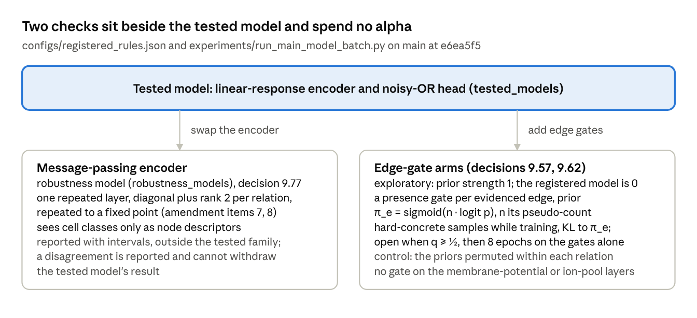

*robustness and exploratory arms · registered_rules.json, run_main_model_batch.py, models/edge_gates.py on main at e6ea5f5; built and decided agree*

Neither arm can change the confirmatory verdict: the message-passing reading is reported beside it, and the edge-gate arms are not part of the registered model.

### How the propagation works

The block diagram above names the transforms; this one shows what they do to a signal. A knockout enters at one node, and every edge passes a signed share of its source to its target, over and over, until the whole field stops moving.

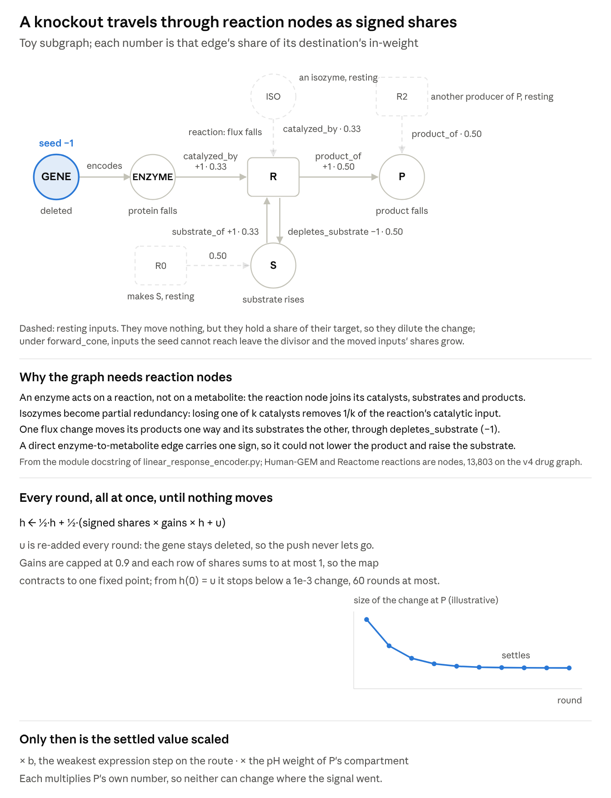

*linear_response_encoder.py and forward_cone_divisor.py on main; the toy graph and the convergence curve are illustrative, not measured*

The resting input is the part worth dwelling on. Under the old `total_in_degree` divisor it still took its share, so an input that never moves diluted the one that did. `forward_cone` counts only the edges the seed can reach, which is decision 9.16 and what PR #8 landed on 24 October.

### How the modules work

A module is a set of nodes the fit chooses, through a gate per node pushed toward zero, so most nodes end up in no module. Nothing anchors a module to a known pathway: the 16 curated pathway modules in `docs/curated_pathway_modules.csv` are a comparison table, not the model's starting point.

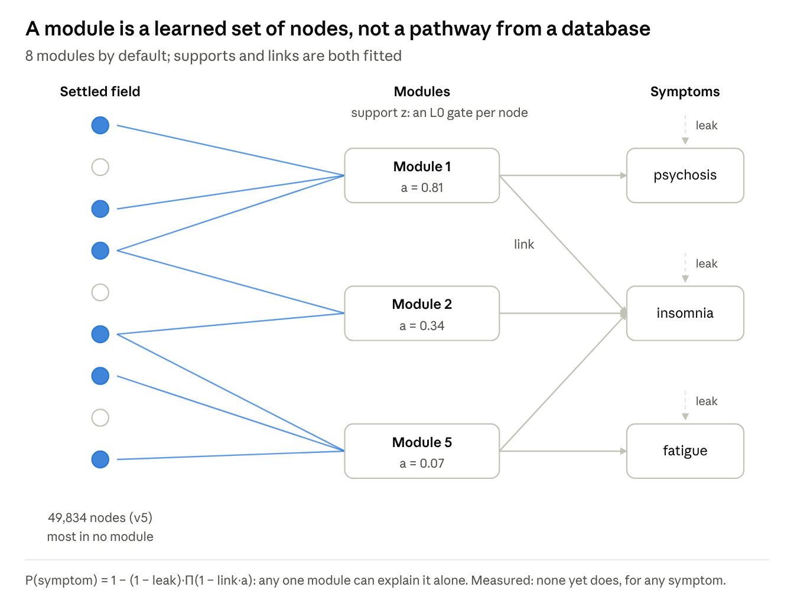

*noisy_or_pathway_module_model.py on main, --num-modules default 8; sufficiency from docs/physiological_adherence_review.md section 13*

This is where the nosology would come from, and also where the clearest negative result sits. Modules overlap, so two symptoms become related when one module explains both. But the sufficiency test found the own-ablation interval excluding zero in 0 of 62 symptom-module rows, so no module yet explains any symptom on its own, which is the premise of the noisy-OR form failing on its own terms. Every symptom is also a monotone function of the same 8 activations, so untrained symptoms rank the perturbations identically, at correlation 1.000000.

### What a module is, biologically

Two different things go by the name, and keeping them apart matters. The **curated** modules are sixteen hand-built pathways used as a yardstick. The **learned** modules are the eight gates the model fits, which is what the nosology would be read from.

The curated set shows what an interpretable module looks like: a metabolic or transmitter route where a gene disorder and a drug act on the same chemistry. The monogenic and drug anchors are what make it a bridge rather than a gene list.

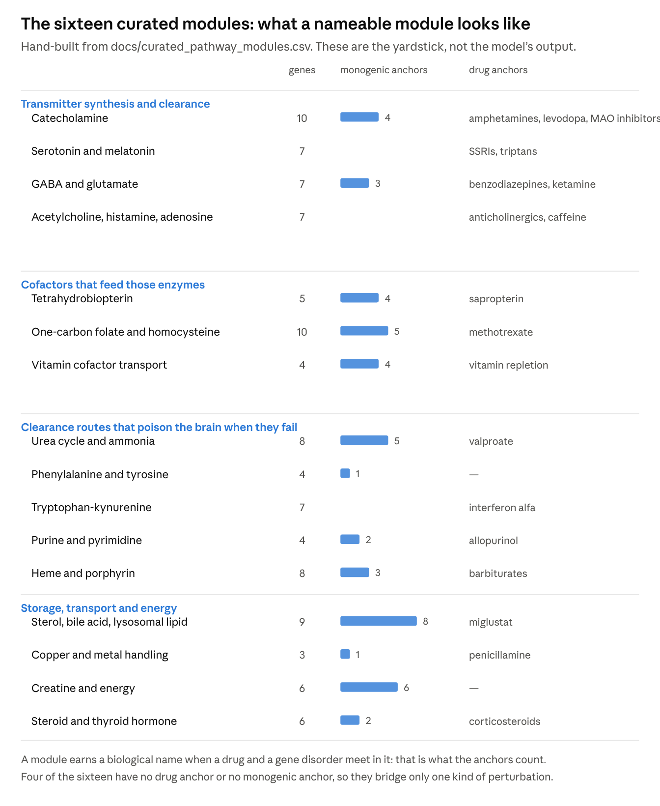

*docs/curated_pathway_modules.csv on main; groupings are mine, the modules and their anchors are the file's*

The learned ones are a different story, and this is the part worth knowing before building anything on module interpretation. Across ten development pilots, 400 supports were analysed by a naming rule that asks what a support is made of.


*docs/module_names.md, generated by experiments/measure_module_name_availability.py; ten development pilot runs, which the document does not tie to a graph build*

So the honest answer to "what is each module" is that, on the pilots, almost none of them is anything yet. 314 of 400 supports are mixed, with no subsystem holding even a quarter of them. Eight take a curated module's name, and every one of those eight is inert: its activation varies by 0.021 or less across the held-out perturbations, six of them by exactly 0.000. A module that never changes cannot explain a symptom, so nothing yet occupies the overlap the nosology needs, where a module is both nameable and responsive.

Three caveats on reading that. These are development pilots, and `docs/module_names.md` does not say which graph build they ran on, so under decision 9.82 they are history rather than evidence about the current graph. The naming rule is strict by design, and "mixed support" is a real result rather than a failure to label. And the runs used 40 modules, not the current default of 8.

### Where the parameters are

Counting the defaults makes the model's shape plain: the physiology is almost parameter-free and the head is almost all of the budget.

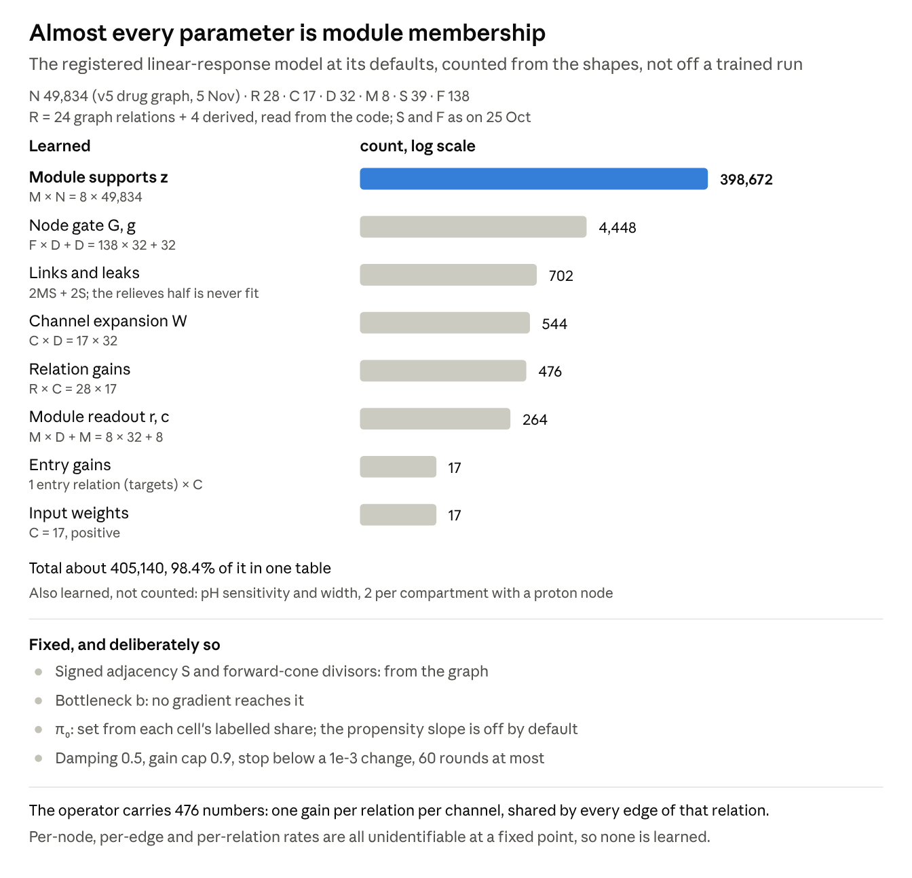

*counts derived from the argument defaults in experiments/run_main_model.py and the shapes in models/; not read off a trained run*

Two things follow. The operator's 476 gains (28 relations × 17 channels) are each shared by every edge of their relation, which is the "one global ratio" problem of the adherence review: one elasticity per relation cannot raise one metabolite and lower another through the same relation pair. And the module supports are the only per-node parameters in the model, which sits oddly beside the design rule that parameters are "never per node, since a per-node parameter is memorisation that cannot transfer to a held-out gene". The held-out split is over perturbations rather than nodes, so a node's gate is still trained by every other perturbation that reaches it; I have not found a document that works that through, so treat it as a question to put rather than a fault to report.

### What each quantity means

Read top to bottom, this is the diagrams' data flow. Shapes use the key above; "arbitrary units" means the scale is set by the input magnitude and the learned weights, so only sign and ratios carry meaning.

| Quantity | Meaning | In biological terms | Range or units |
| --- | --- | --- | --- |
| **Inputs** |  |  |  |
| seed index \[B, P\] | The graph nodes a perturbation acts on: a gene's node, or a drug's entry node | The molecule the intervention touches directly: the gene whose dosage a variant changes, or the receptors and enzymes a drug binds | node ids; −1 pads |
| sign and magnitude \[B, P, 2\] | Direction of the change at each seed (+1 gain, −1 loss) and its size | Loss or gain of function and its degree: a deletion against a duplication, an antagonist against an agonist. Most drugs enter at 1, the same size as a complete knockout or full activation, whatever their dose or occupancy | sign ±1; magnitude ≥ 0 |
| graph edges | Directed links with a biological sign and a weight (a conductance share for item 13's edges, else 1) | A known mechanism: a transcription factor regulating a gene, a kinase activating a protein, an enzyme catalysing a reaction, a reaction consuming or producing a metabolite, a receptor coupling to a G protein, a channel conducting ions | sign −1, 0, +1 |
| class weights w \[N, Q\] | Expression of each node in each cell class | How much each cell type (excitatory neurons, astrocytes, locus coeruleus, pineal and the rest) expresses a gene, from HPA, GTEx and the Siletti atlas | \[0, 1\] |
| node features \[N, F\] | Node kind and descriptors; they enter only the output gate, never the propagation | What a node is (gene, protein, metabolite, reaction, ion pool); no biology enters the propagation through it | mixed |
| **Fixed structure** |  |  |  |
| S \[R·N, N\] | Signed share of a target's total incoming weight that each edge carries | How much of a molecule's turnover one mechanism accounts for. A metabolite made by five reactions and used by one rises when production rises; losing one of k isozymes removes 1/k of a reaction's catalysis (partial redundancy) | each row's absolute values sum to ≤ 1 |
| cone rescale | How much larger an edge's share becomes when only edges the seed can reach count in the divisor | Inputs the perturbation never moves sit at their resting level, so they do not dilute the change arriving from the moved ones. Whether resting inputs should dilute it is the 9.16 modelling choice, not an established fact | ≥ 1 |
| b \[N, B, Q\] | Expression level of the weakest step on the best route from the seeds to a node, in one class: a throughput ceiling | The rate-limiting step: a cell type that barely expresses one enzyme or transporter on the route cannot carry the change past it, however well it expresses the rest | \[0, 1\] |
| **Encoder** |  |  |  |
| u \[B, N, C\] | The sustained push applied at each seeded node, held for the whole run; zero elsewhere | A chronic exposure: a lifelong change in gene dosage, or steady drug occupancy at a maintenance dose | arbitrary units |
| gain\_r \[R, C\] | Fraction of a source's change that relation r passes to its target; under the metabolic control reading, an elasticity times a flux share | How sensitive a target is to its input through one kind of mechanism, such as how much a reaction rate moves per change in its substrate. Every edge of one type shares it, though real sensitivities differ edge by edge | (0, 0.9); binds (−0.9, 0.9) |
| entry gain | Strength of a drug's mechanism edge, per channel | How strongly drug engagement changes target activity, per mechanism type (inhibition, agonism and so on). Shared across drugs, so it is not any one drug's potency or affinity | (0, 1) |
| h \[N, B, C\] | Steady-state deviation of each node from its unperturbed state; the unperturbed field is 0, so this is the difference field | The new steady state against baseline: dopamine up, a transcript down, the membrane depolarised. It contains no receptor adaptation, and its size is not calibrated to any measured concentration | arbitrary units; sign = up or down |
| channels C = Q × per-class | Parallel copies of the propagation, one group per cell class, each with its own gains | The same perturbation followed separately in each cell type, with extracellular metabolites shared so a transmitter one cell type releases reaches the others | count |
| w\_pH \[N, B, C\] | Fraction of activity a node keeps given the pH shift in its compartment | An enzyme's pH-activity curve: reactions in an acidified or alkalinised compartment, such as the lysosome, slow down. Inert in current runs | (0, 1\]; ≈ 1 in practice |
| node gate \[1, N, D\] | How much of each readout feature a node passes on, by node kind | None directly: it lets the readout weight some kinds of molecule, metabolites over transcripts for example, more than others | (0, 1) |
| field \[B, N, D\] | The deviation re-expressed as D learned features per node: what the head reads, not a physiological quantity | None directly: learned combinations of the steady-state changes | arbitrary units |
| **Head and loss** |  |  |  |
| z \[M, N\] | Membership of node n in pathway module m; sparse by the L0 relaxation | The molecules that make up one mechanism, chosen by the data rather than taken from a pathway database | \[0, 1\] |
| a \[B, M\] | How strongly perturbation b engages module m | How far the perturbation disturbs that mechanism. The pooled sum is signed, so a rise and a fall inside one module can cancel | \[0, 1\] |
| link \[M, S\] | Probability that module m, fully engaged, produces symptom s (a second matrix for relieves) | A penetrance at the level of a mechanism: how often a fully disturbed mechanism shows up as that symptom | (0, 1) |
| leak \[S\] | Probability of symptom s from causes outside every module; starts at the training base rate | Everything the modules leave out: background prevalence, nocebo and reporting effects, and mechanisms not in the graph | (0, 1) |
| P \[B, S\] | Predicted probability that perturbation b produces (or relieves) symptom s | Whether the gene or drug is associated with the symptom: penetrance-like for a variant, an adverse-event association for a drug, a therapeutic effect under relieves. It is not an incidence rate, since the labels are present or absent | (0, 1) |
| π | Labelling propensity: chance a real link would have been reported. π₀ = w + (1 − w)·r, with w = 0.2 and r the cell's labelled share; the Equations table below gives the full form | Ascertainment: well-studied genes and widely used drugs have more of their real effects documented | (0, 1) |
| description length | Expected number of active support nodes plus the sum of link probabilities: the cost of a larger model | None: a parsimony preference for fewer mechanisms, each with fewer molecules | count |
| loss | Negative log-likelihood of the labels plus the description length | None: a fitting criterion | scalar |

The modules are the candidate units of the nosology: a module is a set of nodes (z) tied to a set of symptoms (link), so two symptoms share a module when the same mechanism explains both.

### Equations

Each row gives the formula, what its symbols mean and the file on `main` that defines it. The repository is the authority; these are transcriptions.

| Quantity | Formula | Symbols | Defined in |
| --- | --- | --- | --- |
| Fixed point | h ← (1−d)·h + d·(Σ\_r g\_r·S\_r·h + u) | d damping 0.5, g\_r relation gain, S\_r signed adjacency, u sustained input | [linear\_response\_encoder.py](https://github.com/TimeDelta/perturbation-symptom-modules/blob/main/mechanistic_pathway_learning/models/linear_response_encoder.py) |
| Contraction bound | \|g\_r\| ≤ 0.9, and each row of Σ\_r \|S\_r\| ≤ 1 | what guarantees one fixed point | [linear\_response\_encoder.py](https://github.com/TimeDelta/perturbation-symptom-modules/blob/main/mechanistic_pathway_learning/models/linear_response_encoder.py) |
| Forward-cone divisor | row × (total ÷ cone divisor) | the cone divisor counts only in-edges the seed can reach | [forward\_cone\_divisor.py](https://github.com/TimeDelta/perturbation-symptom-modules/blob/main/mechanistic_pathway_learning/models/forward_cone_divisor.py) |
| Limiting-step bottleneck | b = max over routes of min over nodes | per cell class, on the unsigned structure, applied after the loop (`class_bottleneck`) | [linear\_response\_encoder.py](https://github.com/TimeDelta/perturbation-symptom-modules/blob/main/mechanistic_pathway_learning/models/linear_response_encoder.py) |
| Compartment pH weight | ΔpH = −log10(1 + s·δ), w = exp(−(ΔpH/width)²) | s sensitivity (never calibrated, so ≈ 1), δ proton deviation | [compartment\_ph.py](https://github.com/TimeDelta/perturbation-symptom-modules/blob/main/mechanistic_pathway_learning/graph/compartment_ph.py) |
| Module activation | a\_m = sigmoid(Σ\_n z\_mn·field\_n·r\_m + c\_m) | z support, r readout vector, c bias | [noisy\_or\_pathway\_module\_model.py](https://github.com/TimeDelta/perturbation-symptom-modules/blob/main/mechanistic_pathway_learning/models/noisy_or_pathway_module_model.py) |
| Noisy-OR | P(s) = 1 − (1 − leak\_s)·Π\_m (1 − link\_ms·a\_m) | leak: causes outside every module; link: module-to-symptom probability | [noisy\_or\_pathway\_module\_model.py](https://github.com/TimeDelta/perturbation-symptom-modules/blob/main/mechanistic_pathway_learning/models/noisy_or_pathway_module_model.py) |
| **Labelling propensity** | π(x,s) = sigmoid(logit(π₀(t,s)) + c·(z(x) − z₀)) | t perturbation type, s symptom, z log(1 + distinct PubMed ids), z₀ its median, c the one learned slope | [positive\_unlabelled\_likelihood.py](https://github.com/TimeDelta/perturbation-symptom-modules/blob/main/mechanistic_pathway_learning/models/positive_unlabelled_likelihood.py) |
| π₀, the fixed part | π₀(t,s) = w + (1 − w)·r(t,s) | w = 0.2 (the old negative weight), r the cell's labelled share on the fit rows. Fixed, not learned: an intercept of π is unidentified against the head's own scale | [positive\_unlabelled\_likelihood.py](https://github.com/TimeDelta/perturbation-symptom-modules/blob/main/mechanistic_pathway_learning/models/positive_unlabelled_likelihood.py) |
| PU likelihood, per pair | positive −log(b + (1−b)·π·f); unlabelled −log(1−b) − log(1−π·f); evidenced negative −log(1 − a·f) | f the noisy-OR P, b false-report rate (0 by default), a the power of the assessment that found the pair absent | [positive\_unlabelled\_likelihood.py](https://github.com/TimeDelta/perturbation-symptom-modules/blob/main/mechanistic_pathway_learning/models/positive_unlabelled_likelihood.py) |
| Description length | expected active support nodes + Σ links | the parsimony term added to the likelihood | [minimum\_description\_length\_selection.py](https://github.com/TimeDelta/perturbation-symptom-modules/blob/main/mechanistic_pathway_learning/models/minimum_description_length_selection.py) |
| Occupancy (not a model input) | θ = C / (C + K) | C unbound concentration at the target's own site, K the affinity | [occupancy\_calibration.py](https://github.com/TimeDelta/perturbation-symptom-modules/blob/main/mechanistic_pathway_learning/perturbation/occupancy_calibration.py) |

Two notes on the propensity, since it is the least self-explanatory. At π = 1, b = 0 and a = 1 the three terms above reduce to plain binary cross-entropy, so π is exactly the knob that separates "not reported" from "not real". And because P(labelled) = π·f ≤ π, a cell's propensity cannot sit below its labelled share: on v5 that share reaches 0.68 for intellectual disability among the genes and 0.87 for somnolence among the drugs, so a flat π = 0.2 is not available for those cells.

A note on the word "time scale", which the encoder's docstring uses of the channels and which is easy to misread. It is not a claim about rounds. The docstring ties it to the gains ("each with its own per-relation gains, so the channels settle at different time scales"), the initialization spreads the gains "so channels start at different time scales", and the project uses the word for a channel throughout, as in `--channels-per-cell-class`. The name has a real referent: in the dimensionless form of the rate-invariance result a gain is coupling divided by relaxation rate, so a channel with larger gains is the image of a slower-relaxing subsystem at the same coupling, and that ratio is precisely what survives at a fixed point once the rates themselves drop out. What the word cannot mean is a duration: no channel settles before another, none carries a clock, and the round index is graph distance rather than time. Read as a marker for processes of different speed, represented the only way a rate-free model can represent them, the phrasing holds.

### Propagation channels

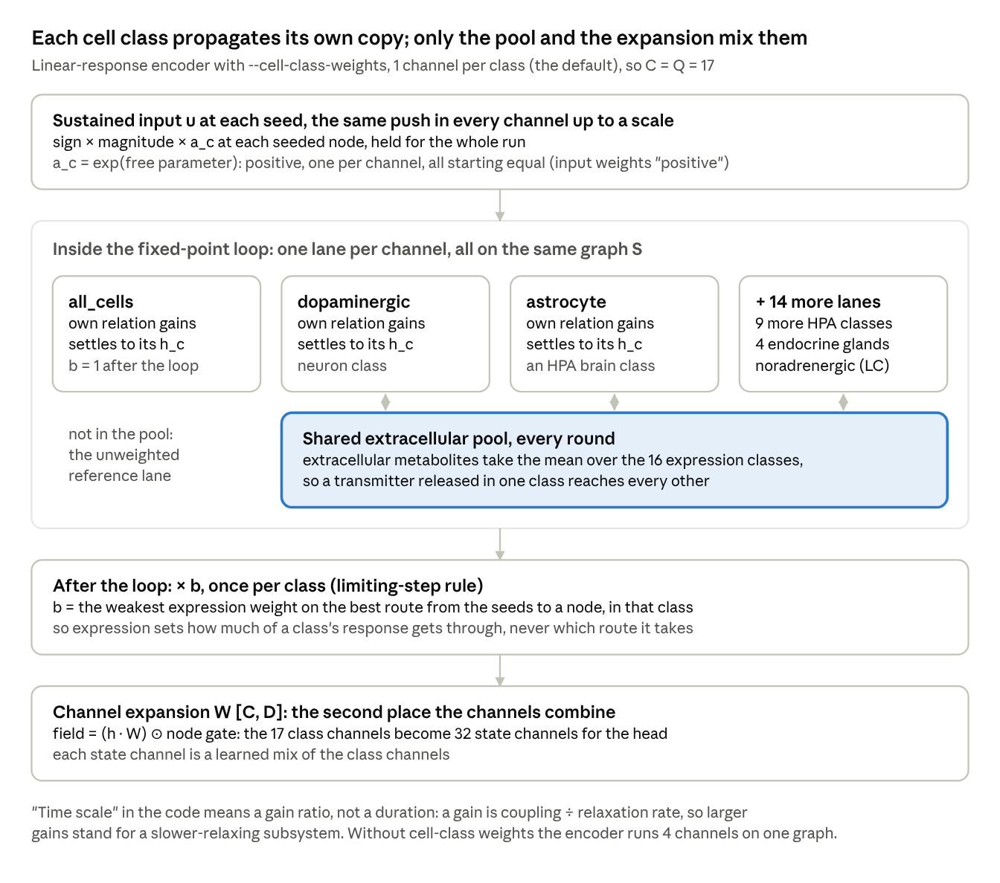

*propagation channels · linear_response_encoder.py and run_main_model.py defaults on main at e14b969; 17 classes as experiments/build_cell_class_weights.py writes them*

Under the limiting-step rule expression leaves the loop, so inside it the 17 lanes differ only in their learned gains. One lane's response reaches another only through the shared extracellular pool and the expansion W.

### The membrane potential, as built and as decided

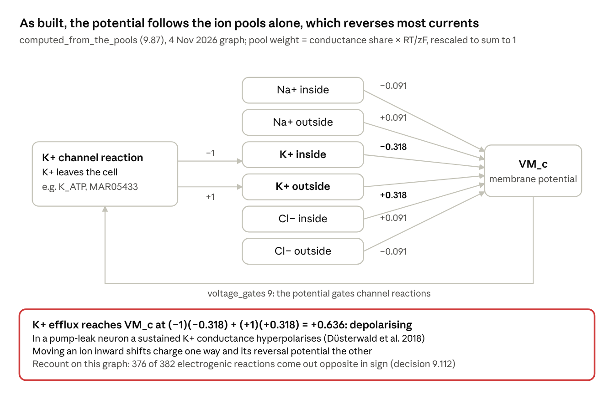

*membrane potential, as built · membrane_potential.py and reactome_import.py on main at e6ea5f5; counts from the 4 Nov graph*

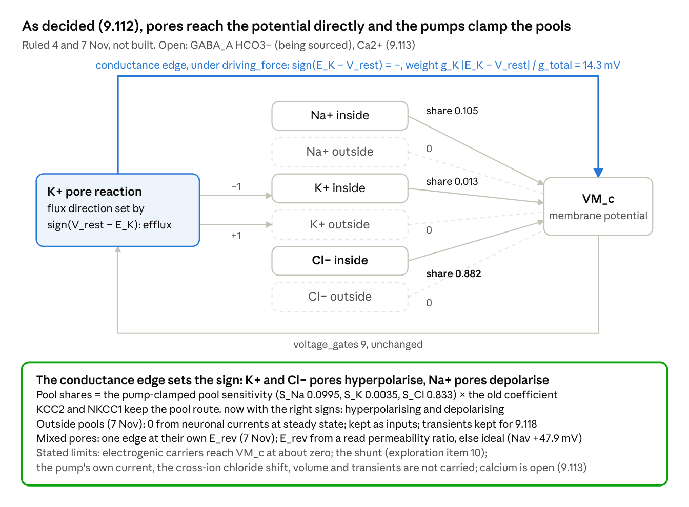

*membrane potential, as decided · decision 9.112 ruled 4 Nov 2026, not built; constants from the Fable review of the same day*

"Gradient" in these two diagrams is the transmembrane ion concentration gradient, not the gradient of the training loss. The pool shares in the decided version are the pump-clamped pool sensitivities, normalised over the three inside pools; the outside pools stay open until 9.112's last question is ruled.

## The registered model on main

One model is tested: the noisy-OR linear-response encoder, at one-sided 0.05, with no magnitude floor. Eleven rules in `configs/registered_rules.json` are asserted against the code by `tests/test_registration_matches_the_code.py`; five amendments follow the frozen 15 October baseline. The four that changed between 20 and 24 October are marked.

| Rule | Value now | Was | Changed |
| --- | --- | --- | --- |
| `tested_models` | linear-response noisy-OR only | that plus message-passing noisy-OR | 22 Oct (9.77) |
| `robustness_models` | message-passing noisy-OR (spends no alpha) | none | 22 Oct (9.77) |
| `alpha_one_sided` | 0.05 | 0.025 per model | 22 Oct (9.78) |
| `normalisation` | `forward_cone`: in-degree counted only over edges the seed can reach | `total_in_degree` | 24 Oct (9.16, PR #8) |
| `label_likelihood` | `positive_unlabelled`, every kept pair counted once | weighted cross-entropy (silent pair at 0.2) | 24 Oct (9.90, PR #17) |
| `floor_rule` | none: paired interval on model minus best baseline | 0.05 fixed and others | 15 Oct |
| `held_out_fraction` | 1/7 of genes and of drugs | — | — |
| `bootstrap_unit` / `num_bootstrap` | leakage group / 4,000 | — | — |
| `minimum_positives_to_score` | 5 positives and 1 negative | — | — |
| `validation_fold_rule` | `seed % 7` | "fold 0" | 15 Oct |

The registered reason for keeping the linear encoder is that it alone has a closed-form steady state, so the sensitivity of a label to a sign-disputed edge can be read without a training run. Your words of 22 October: "Defer it to robustness. I don't want it constraining things because this is more about mechanistically identifiably predictive nosology".

One registered piece does not act: the pH ceiling is inert because no trainer calls `calibrate_ph_sensitivity`, so the settled field there is of order 1e-11. Separately, decision 9.90's row described the weighted loss as the default until a dated correction on 25 October (`24438249`).

## Timeline, 16 to 25 October

In ten days the project went from draft pull requests awaiting review to one registered model on `main`, with no pull requests left open.

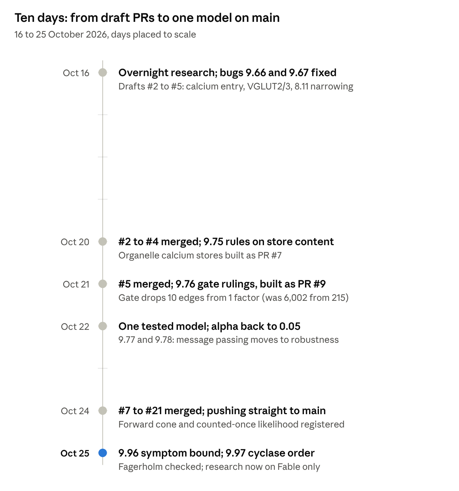

*session notes of 17, 21, 24 and 25 October 2026 and the git log of main*

Two rules changed how work happens: since 24 October work is pushed to `main` once the full suite passes, and since 25 October research runs on Fable only, with engineering on any model.

## Labels and evidence on v5

The v5 label table holds 2,705 perturbations by 39 symptoms; 4,446 positives are kept and 70 pairs are evidenced negatives. Every count here comes from the 22 October build, which was lost with its container, so treat them as approximate until the rebuild.

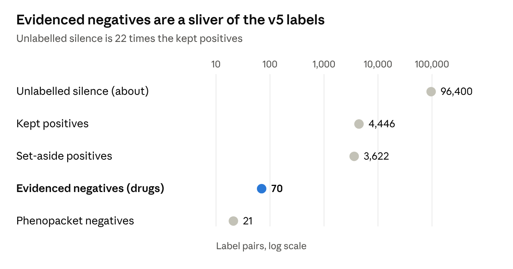

*session_2026-10-22_to_24.md, label table better_v2_full_v5_placebo_negative, 22 Oct v5 build (lost)*

Soft reports are priors, never labels. Their absences are dominated by one species, which matters because 9.94 calibrates mouse on its own fit (139 positive and 2,848 negative cells) and pools fly, rat and zebrafish with the human cells.

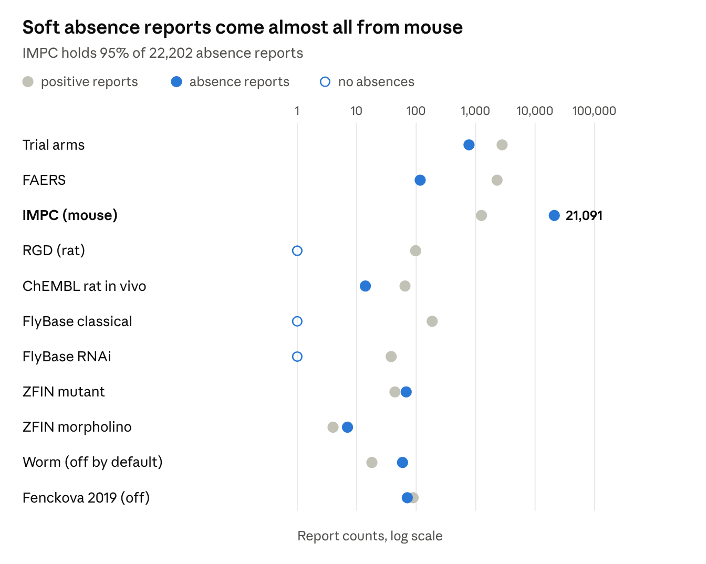

*session_2026-10-22_to_24.md, soft absence reports on the 22 Oct v5 build (lost)*

Edges carry their own negatives: HuRI tested-not-detected on 5,218 `binds` edges, Perturb-seq no response on 13,900 (143 with the edge's sign, 171 against), ChEMBL 96 negative against 400 positive, GO NOT on 127 and IntAct on 16. Negatome contributes none; you stated on 24 October that its data is not available.

## Critical paths

Three paths need a rebuilt v5 graph, so ordering them saves work: if the cyclase correction lands before the rebuild, one rebuild serves the cyclase sweep, the lockbox work and the steady-state tests.

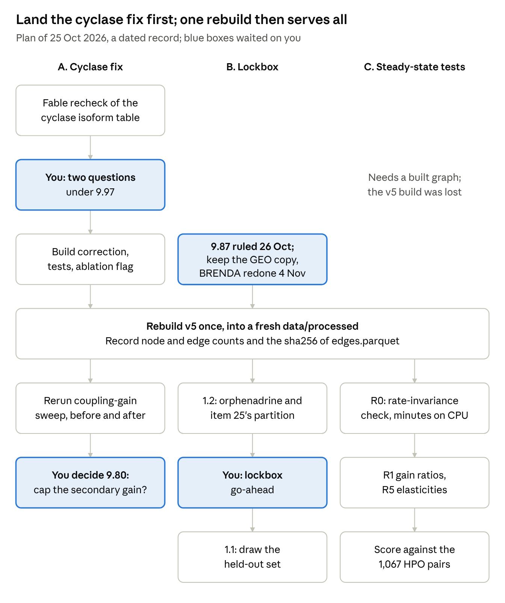

*handoff_g_alpha_cyclase_2026-10-25.md, handoff_v5_session_2026-10-24.md, readout_and_timescales_2026-10-24.md*

The order is my suggestion, not a ruling: the handoffs list the rebuild separately under each path. Two traps apply whatever the order. `scripts/rebuild_data_layer.sh` skips every step whose output exists, so it must build into an empty directory. In the coupling sweep, unsigned `binds` must stay at gain 0, because a negative base logit through 0.9 tanh reverses signs across the graph.

After the sweep, 9.80 has four options, from a zero-parameter cap of the secondary gain at the primary gain to 668 per-edge strengths on both coupling types. Your scope of 24 October: "I don’t need full per edge coupling strengths though, just on certain relation types, right?"

## Things only you can do

Nine items need a human: three are files to keep or open, three are licence or robots checks and three are rulings that unblock a source.

| Item | Why only you | Blocks | Note |
| --- | --- | --- | --- |
| Keep a copy of GEO GSE100472 (four files, 6.1 MB) outside the container | NCBI refuses automated readers | pineal class of 9.76 on every rebuild | `session_2026-10-20_to_21.md` |
| Tick the licence on BRENDA's download page | a click-through licence | regenerating #14's BRENDA table (9.88) | `session_2026-10-22_to_24.md` |
| Open Zou et al. 2025, AAPS J, and its 2026 correction | not open access | the only paper covering this project's drug classes for Kp,uu,brain | [doi](https://doi.org/10.1208/s12248-025-01035-8), [correction](https://doi.org/10.1208/s12248-026-01256-5) |
| Open Dessauer et al. 2017, Pharmacol Rev 69:93 | PMC and the publisher blocked automated reading | step 1 of 9.97 if no other source covers every cyclase isoform | [doi](https://doi.org/10.1124/pr.116.013078) |
| Open RGD's citing page | robots-blocked for the reader | 9.94 item 6, the rat licence | https://rgd.mcw.edu/wg/citing-rgd/ |
| Rule on ClinicalTrials.gov's robots file, which disallows `/api/` | your call, as for EBI's FTP | the trial fetcher (API v2) | `session_2026-10-22_to_24.md` |
| Rule on WormBase read through EBI's mirror | CLAUDE.md forbids mirrors | worm classes (off by default) | 9.94 item 1 |
| Fagerholm: withdraw-and-record or delete | your plain-reading instruction meets the documentation rules | item 15's disclosure text | `fagerholm_exclusion_2026-10-25.md` |
| Lockbox go-ahead | your rule: "Don't finalize the lockbox until I've given the go ahead" | 1.1, after 1.2 | do not run `draw_lockbox.py` before it |

The Siletti cluster aggregate (294 MB) has a fetch line, but it points at a Dropbox address that may rot; keeping a copy is cheap insurance.

## Concepts to study

Five ideas carry most of the recent decisions: the fixed point, why rates drop out of it, where linearity binds, forward-cone normalisation and the counted-once likelihood.

### 1. The fixed point

The linear encoder repeats one update until the state stops moving: damping d = 0.5, the input re-added every round, tolerance 1e-3, at most 60 rounds. Every relation gain satisfies |gain\_r| ≤ 0.9 and every row of the summed absolute adjacency sums to at most 1, so the map is a contraction and the fixed point is unique.

```latex
h_{t+1} = (1-d)\,h_t + d\,\big(\textstyle\sum_r \mathrm{gain}_r S_r h_t + u\big)
```

### 2. Why relaxation rates cannot move it

With D the diagonal of relaxation rates and couplings held dimensionless (G = D⁻¹A), D cancels at steady state. Metabolic control analysis says this is the physical reading: a steady-state gain is an elasticity times a flux share.

```latex
\frac{dh}{dt} = D\,(-h + G h + \tilde u) \;\Rightarrow\; h^* = (I - G)^{-1}\tilde u
```

So the HPO sign failure is a failure of gains, signs and structure, not of time. Rates reappear only in the dosing harmonics, where D⁻¹ multiplies iω.

| Label class | Equilibrium it reads | What is missing |
| --- | --- | --- |
| Germline variant, HPO laboratory abnormality | full fixed point | developmental residue, episodic decompensation |
| Chronic exposure, late adverse event | full fixed point of the mean dose | receptor adaptation loops |
| Single or early dose, acute adverse event | fast-subsystem fixed point, transcription and `encodes` frozen | nodes whose relaxation time is near the observation time |

The partition is by relation, not by node: a protein keeps its fast binding and catalysis while its slow `encodes` edge is frozen.

### 3. Where linearity binds

Eight cases need a nonlinearity; the in-loop aggregators stay safe only because each statistic is odd and positively homogeneous, and saturation breaks exactly that.

| # | Case | Size or status | Evidence it needs a nonlinearity |
| --- | --- | --- | --- |
| 1 | Two drugs competing at one site | 1,184 of 9,908 triples share a site | **Needed.** Occupancy by two ligands at one site is a ratio, so one drug's effect is divided by the other's concentration over its affinity ([Cheng and Prusoff 1973](https://doi.org/10.1016/0006-2952%2873%2990196-2)). Review section 12: "competition is saturable and so cannot be a relation inside a linear propagation". Caveat: with single-drug labels it bites mainly against endogenous ligands. |
| 2 | Partial agonists, PAMs and NAMs | 41 drugs, 33 with no other target kind | **Needed.** Review section 12: the fix is "scaling the endogenous ligand's state rather than adding to it", which "is not linear". Allosteric modulators have "a ceiling level to the allosteric effect" ([Christopoulos and Kenakin 2002](https://doi.org/10.1124/pr.54.2.323)). A pure PAM does nothing without its orthosteric ligand: a product, not a sum. |
| 3 | Complex members: all needed or any one | 542 conjunctions, 238 disjunctions, not told apart | **Needed once marked.** An all-members complex is a minimum and an any-member one a maximum; a weighted sum is neither. The message-passing encoder already uses `conjunction_aggregation = "minimum"`, and the review calls the gap "a live difference between the two registered encoders". The data step comes first: the graph does not yet mark which entities are conjunctions. |
| 4 | Receptor adaptation | not represented anywhere | **Partly.** Desensitisation scales a receptor's gain by its own occupancy, a product of states. But a linear negative-feedback loop already gives partial adaptation, and integral feedback gives perfect adaptation: "integral control in some form is necessary for a robust implementation of perfect adaptation" ([Yi et al. 2000](https://doi.org/10.1073/pnas.97.9.4649)). Review section 11 calls adaptation "the largest unrepresented piece of pharmacology in the study". |
| 5 | Knockout against inhibitor (no occupancy) | 154 of 222 drugs carry total input 1 | **Weak for propagation.** Occupancy C / (C + K) saturates in concentration, but each drug enters at one therapeutic concentration, so occupancy can be a per-drug input weight computed before the loop. The fault is in the input: 154 of 222 drugs enter at 1, the size of a complete knockout or full activation, whatever their dose. |
| 6 | Compartment pH ceiling | registered but inert | **Conditional.** pH is the log of \[H+\], and the registered form ΔpH = −log10(1 + s × deviation) is nonlinear; item 22b exists because it broke evenness. It needs to be inside the loop only if pH feeds back on other nodes, such as lysosomal enzymes. At cytosolic H+ the settled field is of order 1e-11, so the case may be moot (inventory open question 3). |
| 7 | Dosage asymmetry | every gene perturbation | **Strongest.** Loss saturates at zero activity and gain does not, while the linear response is odd by construction. Human genetics is not symmetric: according to PubMed, Collins et al. 2022 identify "2,987 haploinsufficient and 1,559 triplosensitive genes", 648 of them uniquely triplosensitive ([doi](https://doi.org/10.1016/j.cell.2022.06.036)), and MECP2 duplication overlaps Rett syndrome rather than mirroring it ([Ramocki et al. 2010](https://doi.org/10.1002/ajmg.a.33184)). |
| 8 | Multistability, hysteresis, oscillation | excluded by the contraction bound | **Needed if the labels depend on it.** A linear system has one fixed point or a continuum and no isolated limit cycle, so bistable switches and the circadian clock cannot be represented. Clock edges exist in CollecTRI. Whether any label depends on these dynamics is unmeasured. |

### 4. Forward-cone normalisation

Each edge is divided by its destination's in-degree over all relations, counting only edges whose source the seed can reach. The divisor is therefore per seed and computed inside the loop. Two combinations are refused rather than handled: the `softmax_mixture` aggregator and edge gates.

### 5. The counted-once positive-unlabelled likelihood

Every kept pair enters once. With f the probability the link is real, π the labelling propensity (0.2 floor plus the cell's labelled share), b the false-report rate (0) and a the power of a never-above-placebo negative:

```latex
\ell_{+} = -\log\!\big(b + (1-b)\,\pi f\big),\quad \ell_{0} = -\log(1-b) - \log(1-\pi f),\quad \ell_{-} = -\log(1 - a f)
```

### 6. Sign disputes

The two CollecTRI releases in OmniPath give opposite signs for 3,795 regulation edges, 1,930 of them labels. A 16-label recuration found the stored sign right on 7 of 11 decidable pairs, too few to set a prior from (decision 9.72).

## Corrected numbers and claims

Seven statements made in earlier sessions were later shown wrong; if you see the left column anywhere, it is stale.

| Stale | Correct | Source |
| --- | --- | --- |
| Sign check 0.615 against 0.806 | **0.593 over 83% of pairs against a 0.757 majority** at convergence; 0.615 was an 8-round transient over 59% of pairs | `readout_and_timescales_2026-10-24.md` section 2 |
| Heterogeneous relaxation rates break the zero-row-sum cancellations | They cannot; rates drop out of the fixed point under dimensionless couplings | same, section 1 |
| "HPA ranks the classes opposite to mouse" | Aggregation artifact (per-gene maximum over cluster types); per cluster type HPA follows the mouse direction | `session_2026-10-22_to_24.md` |
| Kalvass et al. 2007 still not retrievable | You supplied it on 15 October 2026 (9.41) | `README.md` of the notes |
| Section 30.6 filter widening waits on a ruling | You accepted it on 12 October 2026 (89 to 94 drugs) | same |
| Message-passing encoder has a softmax mixture | `softmax_mixture` lives in the linear encoder's `CrossRelationAggregator` | `nonlinearity_inventory_2026-10-21.md` section 2 |
| Fenckova et al. 2019 "all rights reserved" | CC BY-NC-ND 4.0, read on the version of record | commit `77b87fa` |

One interpretive point travels with the Fagerholm exclusion: the preprint's author blames the noisy **human** measurements for the rat-to-human R² of 0.01, not the rat values, while the repository read it the other way. His conclusion: "available human Kp,uu,brain-data are too uncertain to be applicable for validation" (`fagerholm_exclusion_2026-10-25.md` section 3).

## Critique: where the project is weakest

The largest risk is not a missing feature: at convergence the graph's signs predict symptom direction worse than always guessing the majority sign (0.593 against 0.757). Until R1 or R5 moves that number, the operator has not yet shown it carries sign information the labels can see.

1. **No current graph exists.** The only data release is v0.4 (33,964 nodes), which you called outdated on 20 October. The name `graph_full_neuronal_split_binders_drugs_v5` covers two builds, and the 22 October build that every v5 count rests on was lost with its container, from an unrecorded commit. Every number in the label section below is unreproducible until the rebuild.
2. **Mirror symmetry is a nosology problem, not only a physiology one.** The linear operator makes a gain of dosage the exact opposite of a loss (inventory case 7). Clinical genetics does not behave that way. According to PubMed, MECP2 duplication in males causes hypotonia, severe intellectual disability, autistic features, epilepsy and regression ([Ramocki et al. 2010](https://doi.org/10.1002/ajmg.a.33184)), which overlaps loss-of-function Rett syndrome rather than mirroring it. A nosology built on the registered operator would place such pairs on opposite sides by construction. Whether items 20 and 22 keep the mirror property is still open (inventory open question 4).
3. **The cyclase error is probably not unique.** All nine adenylyl cyclases received the same five inhibitory Gi/o edges, although at least ADCY2, 4, 7, 3, 8 and 9 are reported Gi-insensitive in the 24 October table, which still awaits its Fable recheck. A uniform pattern across isoforms looks like family-level filling; #11 brought whole HGNC G-alpha families into the 9.23 filter, and 9.22 asks the receptor-side version of the same question. Expect the same class of error wherever an effector family was filled in uniformly.
4. **Negative evidence is thin where it counts.** Of the 105,495 pairs on v5 (2,705 perturbations × 39 symptoms), 70 are evidenced negatives (drugs never above placebo), against 4,446 kept positives. The positive-unlabelled likelihood handlesk this honestly, but per-source reliability measured on negatives (your stated preference, 22 October) has little to be measured on.
5. **Exposure rests mostly on rodents.** Kp,uu,brain exists for 94 of 222 drugs and is human for 13. Any occupancy or exposure layer inherits that.
6. **The 8.2% binds-edge precision depends on an open assumption.** It is measured against HuRI, whose sensitivity (2% or 14.1%) is still undecided in 9.91; quote the two together.
7. **The decision log grows faster than it closes.** 90 open against 60 closed, with 80 waiting on you. The inventory note itself warns that some recurring problems are "partly the same analysis being re-derived". A tag in `docs/open_decisions.md` that separates *gates work* from *record only* would cut the list you need to hold in mind to a handful.

## Parked ideas and sources

Three ideas are parked behind the qualifying exam and none is started (`exploration_queue.md`).

| Idea | One line | Cheapest step |
| --- | --- | --- |
| Sensitivity-matrix rank | Rank of label sensitivities to the 3,795 sign-disputed edges bounds how many independent questions the branch multiverse holds | one adjoint solve per labelled outcome on the linear encoder |
| Larger CollecTRI recuration | 11 decidable pairs give a posterior of roughly 0.35 to 0.85 for the stored sign | a larger seeded sample |
| Protein electrostatics | Maps onto inventory cases 1, 2, 4, 5 and 8; the graph has no rate constants, so no clock to read from | a structure-based affinity prior on `binds` edges |

The PK layer is decided in outline: no QSAR for half-life (172 of 222 drugs already covered, and 97 sit inside the Obach training set), extract FDA label PK instead, and treat Kp,uu,brain as the binding constraint.

### Notes in this Project

Read the repository first: `CLAUDE.md`, then `docs/status.md` and `docs/open_decisions.md`. Of the Project notes, only `handoff_g_alpha_cyclase_2026-10-25.md` is current work; `overnight_2026-10-17.md`, `session_2026-10-20_to_21.md` and `nonlinearity_inventory_2026-10-21.md` are history only (`claude/README.md`).

Repository state read on 25 October 2026 from [docs/status.md](https://github.com/TimeDelta/perturbation-symptom-modules/blob/main/docs/status.md) and [configs/registered\_rules.json](https://github.com/TimeDelta/perturbation-symptom-modules/blob/main/configs/registered_rules.json) at `f54e3e9`. No Zotero connector is available in this session, so Ramocki et al. 2010, Zou et al. 2025 with its correction and Dessauer et al. 2017 are not added to your library from here.
